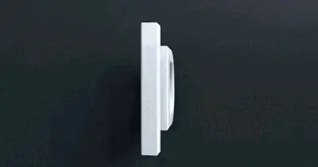
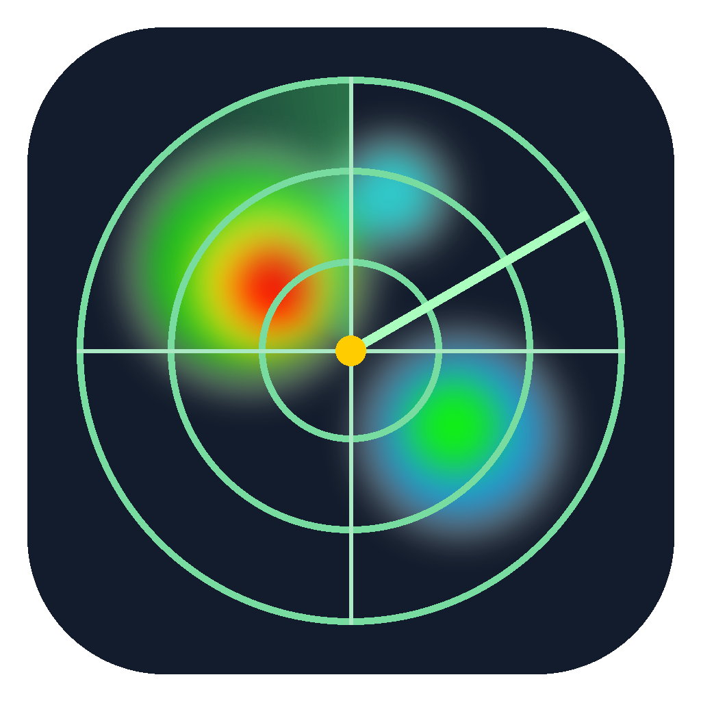
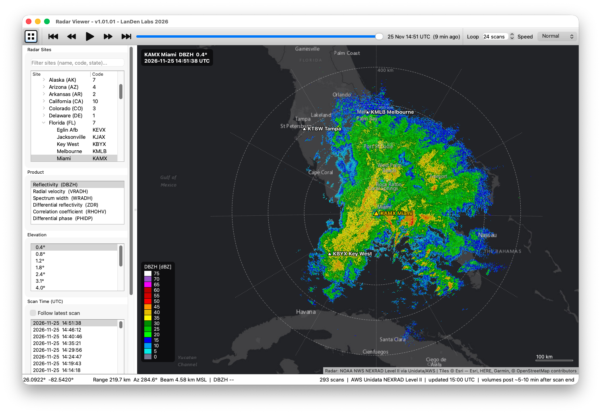
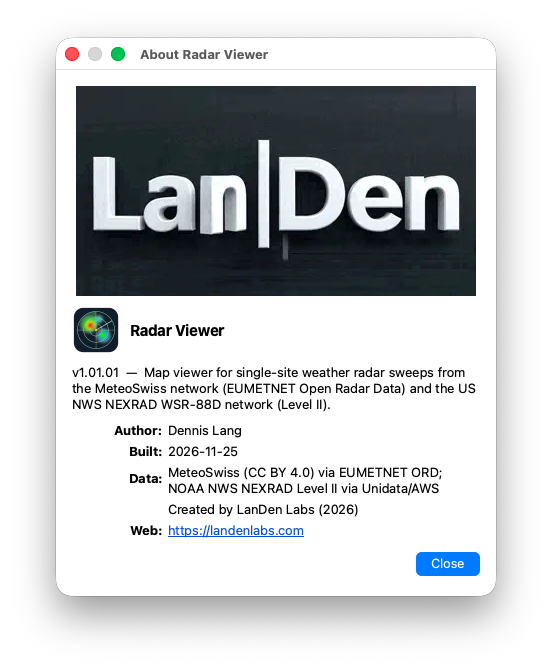

<table border="0">
  <tr>
    <td>
      <!-- VERSION -->v1.01.01<br>
      <!-- DATE -->25-Nov-2026<br>
      macOS &nbsp;|&nbsp; Windows &nbsp;|&nbsp; Linux<br>
      <a href="https://landenlabs.com">Home</a>
    </td>
    <td>
      <a href="https://landenlabs.com">
        
      </a>
    </td>
  </tr>
</table>



# Radar Viewer (qt-radar)

A Python + Qt (PyQt6) map viewer for **single-site weather radar** data from two
networks, drawn as PPI sweeps on a pan/zoom basemap:

- **MeteoSwiss (CH)**: the five Swiss C-band radars. MeteoSwiss's own map and app
  only show the merged composite.
- **NWS NEXRAD (USA)**: all 159 WSR-88D radars, including Alaska, Hawaii, Guam,
  Puerto Rico and the DoD sites in Japan and Korea. Full Level II volumes.

**By [LanDen Labs](https://github.com/landenlabs) (2026)**

---

## Screenshots

**Main window**: the navigation panel (sites, product, elevation, scan time, display options)
on the left, with a radar sweep drawn over the basemap.



**About dialog**



---

## Features

- **Explorer-style layout.** Menu bar across the top, a timeline toolbar, a collapsible
  navigation panel on the left (Ctrl+B or the *Navigation* button, or drag the
  splitter), and the map viewer filling the rest of the window.
- **Navigation panel**
  - **Radar Sites**: a tree with *MeteoSwiss (CH)* (Albis `chalb`, La Dôle `chdol`,
    Monte Lema `chlem`, Plaine Morte `chppm`, Weissfluhgipfel `chwei`) and
    *NWS NEXRAD (USA)* grouped by state. A filter box matches name, ICAO code or
    state (Ctrl+F). You can also click a site's triangle on the map.
  - **Product**: reflectivity `DBZH`, radial velocity `VRADH` (green = toward the radar,
    red = away). MeteoSwiss adds unfiltered reflectivity `TH`. NEXRAD adds spectrum width
    `WRADH`, differential reflectivity `ZDR`, correlation coefficient `RHOHV` and
    differential phase `PHIDP`.
  - **Elevation**: MeteoSwiss publishes five sweeps (−0.2°, 0.4°, 1.0°, 1.6°, 2.5°).
    For NEXRAD the list comes from the volume coverage pattern (VCP) of the scan on
    screen, typically 9–17 cuts from 0.5° to 19.5°. The selection carries over to the
    nearest cut when the VCP changes.
  - **Scan Time**: every scan in the last 24 h. *Follow latest scan* picks up new
    scans automatically (the list refreshes every 2 minutes).
  - **Display**: basemap, radar opacity, minimum reflectivity threshold, range rings,
    map labels on top of the radar, legend, smooth pixels.
- **Map**: drag to pan, wheel / double-click / `+` `-` to zoom. Basemaps: Esri Dark Gray / Light Gray / Topographic,
  OpenStreetMap, OpenTopoMap, swisstopo Grey, or none. Includes 50 or 100 km range rings, 30°
  azimuth spokes, a scale bar and a legend.
- **Cursor readout** in the status bar: lat/lon, range, azimuth, beam-centre height (4/3-earth
  model) and the data value under the cursor.
- **Loop animation** of the last *N* scans (Space to play/pause, `[` `]` to step).
- **Open local files** with File → Open, or pass one on the command line: ODIM HDF5
  (SCAN or full PVOL volumes) or NEXRAD Level II (`KTLX20261125_140753_V06`, `.gz`).
- Save the map as PNG, or save the current scan's original data file.
- Downloads and decoding run on a background thread pool, so the UI stays responsive.

## Data sources

### MeteoSwiss (CH)

MeteoSwiss publishes single-site volume data through the EUMETNET MeteoGate
[Open Radar Data (ORD)](https://eumetnet.github.io/openradardata-documentation/) service. See also
[MeteoSwiss Polar 3D radar products](https://opendatadocs.meteoswiss.ch/d-radar-data/d5-polar-3d-radar-products).
The viewer reads the public ORD 24-hour S3 cache directly. It needs no API key:

```
<bucket>/YYYY/MM/DD/CH/<site>/SCAN/<site>@YYYYMMDDTHHMM@<elev>@DBZH_TH_VRADH.h5
```

| Bucket | URL |
|---|---|
| ORD primary (CloudFerro) | `https://s3.waw3-1.cloudferro.com/openradar-24h` |
| ORD backup (ECMWF) | `https://object-store.os-api.cci1.ecmwf.int/openradar-24h-backup` |

*Radar → MeteoSwiss Data Source → Automatic* (the default) tries the primary bucket first and
falls back to the backup when the primary has no files. Each file is one ODIM_H5 v2.3
sweep: 360 rays, 500 m bins, out to about 210–246 km. It holds three 8-bit quantities.

### NWS NEXRAD (USA)

NEXRAD Level II volumes come from the public NOAA Open Data Dissemination bucket that
Unidata hosts on AWS. It needs no API key:

```
https://unidata-nexrad-level2.s3.amazonaws.com/YYYY/MM/DD/<ICAO>/<ICAO>YYYYMMDD_HHMMSS_V06
```

The old `noaa-nexrad-level2` bucket now returns AccessDenied. A volume appears roughly
5–10 minutes after its scan ends. The viewer has a built-in Archive II decoder
(bzip2 records, message 31 radials, 8- and 16-bit moments), so no Py-ART is needed. It
resamples each cut onto a regular 0.5° or 1° azimuth grid. Split cuts at low
elevations are handled: reflectivity comes from the long-range surveillance cut (460 km),
and velocity and width from the Doppler cut. The site list (lat/lon/elevation) is
embedded from `api.weather.gov/radar/stations`.

**Canada is not included.** Environment and Climate Change Canada's raw radar volume
scans (ODIM_H5) are a paid, password-protected feed. The free MSC Datamart and GeoMet
services offer only pre-rendered CAPPI images and national composites, not
single-site sweep data.

### Caching

Downloaded files are cached under the OS cache directory, per network. Files older
than 2 days are pruned, and the cache is capped at 2 GB. Map tiles use Qt's disk
cache (200 MB).

Radar data © MeteoSwiss (CC BY 4.0) and NOAA National Weather Service. Basemap tiles
© OpenStreetMap contributors, © Esri, © OpenTopoMap, © swisstopo.

## Install and run

```
pip install -r requirements.txt
python3 radar-viewer.py            # live data
python3 radar-viewer.py sweep.h5   # open a local ODIM file
python3 radar-viewer.py KTLX20261125_140753_V06   # open a NEXRAD Level II volume
```

Requires Python 3.10+, PyQt6, numpy, h5py (h5py is only needed for MeteoSwiss/ODIM files).

## Build

The GitHub Action (`.github/workflows/build.yml`) runs when a `v*` tag is pushed. It builds a
macOS `.app` (zipped) and a Windows `.exe` with PyInstaller and publishes them as a
GitHub Release. Use `set-version.bash` / `set-version.ps1` to bump the version.
After changing `icon.png`, regenerate the icons with `python3 make-icons.py`.

## Privacy

Radar Viewer collects no personal data and has no telemetry. See the
[Privacy Policy](https://landenlabs.github.io/py-radar-viewer/privacy.html)
([source](docs/privacy.html)).

## License

Licensed under the [Apache License 2.0](LICENSE).
